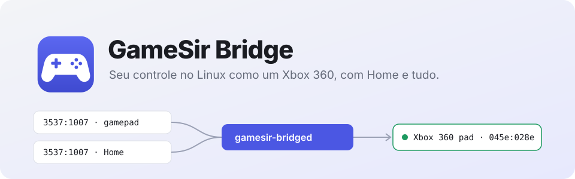

<p align="center">
  
</p>

<p align="center">
  <a href="https://github.com/yurisanp/gamesir-bridge/actions/workflows/ci.yml"></a>
  <a href="https://github.com/yurisanp/gamesir-bridge/releases/latest"></a>
  
  
  <a href="LICENSE"></a>
</p>

**GameSir Bridge** faz o **GameSir T4 Cyclone Pro** (pelo dongle 2.4 GHz) e outros controles
aparecerem no Linux como um **controle Xbox 360**, com todos os botões e o **Home abrindo o
overlay da Steam**. Vários controles ao mesmo tempo, cada um com seu jogador.

- **Funciona em qualquer jogo:** Steam, SDL, Proton e emuladores já conhecem o Xbox 360.
- **Vários controles:** dois dongles iguais viram Jogador 1 e Jogador 2, sem trocar os Homes.
- **Outros controles:** calibre qualquer gamepad em 21 passos, ou contribua com um perfil JSON.
- **Some quando funciona:** um serviço do sistema faz a ponte, mesmo sem nenhum app aberto.
- **Instalação em um passo:** um AppImage para qualquer distro, inclusive SteamOS e Bazzite.

## Instalação

Baixe o `GameSir_Bridge-*.AppImage` da [última release](https://github.com/yurisanp/gamesir-bridge/releases/latest) e rode:

```bash
chmod +x GameSir_Bridge-*.AppImage
./GameSir_Bridge-*.AppImage
```

Na primeira vez ele instala o serviço, a regra udev e as políticas do sistema, pedindo sua
senha **uma vez** (pkexec). Depois, **replugue o dongle**. Para conferir:

```bash
./GameSir_Bridge-*.AppImage status     # ou: gamesir-bridge status
```

<p align="center"></p>

Para atualizar, rode o AppImage novo; ele percebe a versão diferente e reinstala. Para
remover: `./GameSir_Bridge-*.AppImage setup --uninstall`.

<details>
<summary>Instalar a partir do código-fonte</summary>

Precisa de Rust 1.89 ou mais novo.

```bash
git clone https://github.com/yurisanp/gamesir-bridge.git
cd gamesir-bridge
sudo ./install.sh          # compila, instala em /usr/local e ativa o serviço
sudo ./uninstall.sh        # remove (mantém /etc/gamesir-bridge; --purge apaga tudo)
```

Se você usava a versão em Python, o `install.sh` remove o serviço antigo e mantém seu
`/etc/gamesir-bridge/mapping.json`, que continua valendo.
</details>

## Uso

| Comando | O que faz |
| --- | --- |
| `gamesir-bridge status` | Estado de cada controle: ativo, aguardando, sem mapeamento ou erro |
| `gamesir-bridge list` | Interfaces de cada controle, com os códigos evdev (não precisa do serviço) |
| `gamesir-bridge calibrate [id]` | Pede cada botão e eixo em ordem e grava o mapeamento |
| `gamesir-bridge disable [id]` | Desliga a ponte (o controle volta a aparecer como ele mesmo) |
| `gamesir-bridge enable [id]` | Liga a ponte de novo |
| `gamesir-bridge mapping [id]` | Mostra o mapeamento em uso, em JSON |

Com um controle só conectado, o `id` é opcional. Os logs ficam em `journalctl -u gamesir-bridge -f`.

## Controles suportados

| Controle | Perfil | Observações |
| --- | --- | --- |
| GameSir T4 Cyclone Pro (dongle 2.4 GHz, `3537:1007`) | [`gamesir-t4-cyclone-pro-dongle`](profiles/gamesir-t4-cyclone-pro-dongle.json) | LT/RT digitais e sem vibração nesse modo do dongle |
| Qualquer outro gamepad | criado na calibração | `gamesir-bridge calibrate` gera um perfil em `/etc/gamesir-bridge/profiles` |

Calibrou um controle novo? Mande o perfil para `profiles/` num PR: é um JSON só. Veja
[docs/profiles.md](docs/profiles.md) e o [guia de contribuição](CONTRIBUTING.md).

## Como funciona

Plugado no Linux, o dongle tenta se apresentar como um Switch Pro Controller (`057e:2009`),
falha e volta como `3537:1007` em **modo DInput**: os botões saem num gamepad HID genérico e
o **Home** sai como a tecla `KEY_HOMEPAGE`, numa interface "Consumer Control" separada.

O `gamesir-bridged` agrupa as interfaces de cada aparelho pela porta USB, captura todas
(`EVIOCGRAB`) e cria um `Microsoft X-Box 360 pad` (`045e:028e`) via `uinput`, com o Home como
`BTN_MODE`. Uma regra udev esconde o dongle cru para a Steam não ver dois controles.

```text
 app / gamesir-bridge (usuário) ── D-Bus + polkit ──► gamesir-bridged (root, systemd)
                                                          │
             /dev/input/event* (gamepad + Home) ──lê──────┤  perfis JSON + Mapper
                                                          └──cria──► Xbox 360 virtual (uinput)
```

O app e a linha de comando nunca tocam em `/dev/input` ou `/dev/uinput`: pedem tudo ao
serviço pelo D-Bus ([docs/dbus.md](docs/dbus.md)), e o polkit libera a sessão local ativa.

## Limitações

- **Gatilhos digitais:** no modo DInput o dongle manda LT/RT como botões (0 ou 100%).
- **Sem vibração:** o modo DInput não expõe force feedback.
- **M, L4/R4** não chegam ao PC. Programe as traseiras no próprio controle: segure
  **M + L4/R4** até o Home piscar, aperte o botão de destino e depois L4/R4.

## Desenvolvimento

```bash
cargo test --workspace        # testes (o de D-Bus precisa do dbus-daemon instalado)
cargo clippy --workspace --all-targets
```

O código está em dois crates: [`gamesir-core`](crates/core) (mapeamento, perfis, calibração e
descoberta de dispositivos, sem I/O) e [`gamesir-bridged`](crates/daemon) (serviço, D-Bus e
linha de comando). O porte do mapeador é conferido em CI contra o script Python original, caso
a caso. Detalhes em [CONTRIBUTING.md](CONTRIBUTING.md).

Testado em CachyOS (KDE Plasma 6, Wayland), Steam Big Picture, dongle `3537:1007` (bcdDevice 1.01).

## Licença

[MIT](LICENSE). Projeto independente, sem relação com a GameSir.
